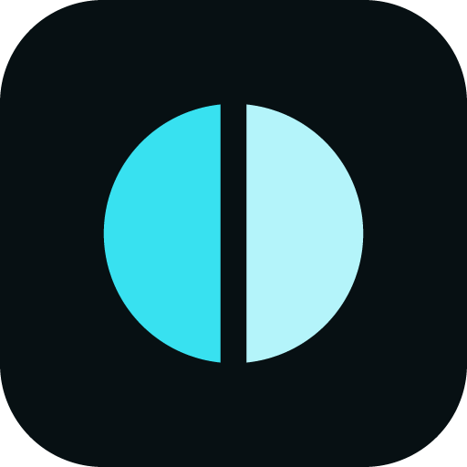

  

<h1 align="center">rcontrol</h1>

Your PC, from your pocket.

A LAN-only remote for Windows: live screen, power, open windows, apps and remote
unlock, from a native Android app. No cloud, no accounts, no port forwarding —
the phone talks straight to your PC on the same Wi-Fi (or over Tailscale).

## What it does

- **Live screen** — the desktop streamed to your phone at 1–15 fps, scaled to
  whatever your connection can carry.
- **Power** — shut down, reboot, sleep, lock, or turn the displays off.
- **Windows** — every open window on the PC, one tap to bring it to the front.
- **Apps** — search the Start Menu and launch anything, or pin your favourites.
- **Unlock** — when Windows is locked, type the PIN/password from the phone.
- **Wake** — magic packet from the phone, or any HTTP endpoint (router, Home
  Assistant, a Pi) before it starts knocking on `/health`.
- **Tray + settings** — a tray icon on the PC opens a local settings page for
  the pairing PIN, port, start-at-login and more.

## Get started

Download the latest [release](https://github.com/PirateTokenThemeSong/rcontrol/releases),
run the server on the PC, install the APK on the phone, pair with the PIN.

→ [Getting started](docs/getting-started.md)

## Documentation

- [Server guide](docs/server.md) — tray, settings, power, windows, apps, unlock
- [Android guide](docs/android.md) — screens, pairing, stream quality, wake
- [Troubleshooting](docs/troubleshooting.md)
- [Internal docs](docs/internal/architecture.md) — architecture, build, CI,
  protocol notes (see also [`protocol/PROTOCOL.md`](protocol/PROTOCOL.md))

## Status

Early days: **v0.1.0**, Windows-first, Android-only, no TLS (LAN trust model).
Releases ship a debug-signed APK for now.
